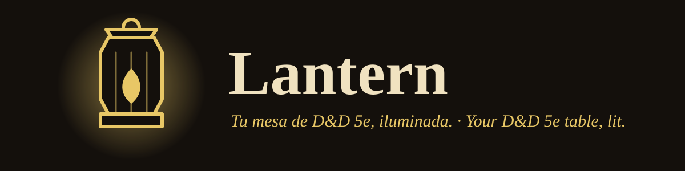

<p align="center"></p>

<p align="center"><b>La mesa virtual de D&amp;D 5e que se instala con un solo comando.</b><br>
Mapa táctico con luz y niebla, combate ágil, tus personajes de D&amp;D Beyond y una mesa lista para invitar a tus jugadores con un enlace.</p>

<p align="center">
  <a href="LICENSE"></a>
  
  
  
  
</p>

<p align="center">🇪🇸 Español · <a href="README.en.md">🇬🇧 English</a></p>

## Instalar en un comando

Abre una terminal, pega el comando de tu sistema y sigue las preguntas del asistente. No necesitas instalar Node, Docker ni nada más.

**Linux y macOS**

```sh
curl -fsSL https://raw.githubusercontent.com/lanterndevv/lantern/master/install.sh | sh
```

**Windows (PowerShell)**

```powershell
irm https://raw.githubusercontent.com/lanterndevv/lantern/master/install.ps1 | iex
```

El script descarga el asistente desde las [releases de GitHub](https://github.com/lanterndevv/lantern/releases), comprueba su SHA-256 y lo abre. Todo lo necesario vive en GitHub: no hay ningún servidor intermedio. Guía paso a paso para quien no sea técnico: [docs/guia-instalacion.md](docs/guia-instalacion.md).

## Qué hace el asistente

Una pregunta por pantalla, con valores por defecto sensatos, teclado o ratón, y ES/EN:

1. **Dónde jugar:** tu propio equipo con un enlace público (túnel de Cloudflare), una máquina gratuita de Oracle Cloud, un VPS barato creado por API, o solo red local / NAS con Docker.
2. **Nombre y HTTPS** (Caddy con certificado automático en servidores remotos).
3. **Inteligencia artificial** (opcional): Laya local para el turno de los monstruos y un proveedor LLM a elegir (con opciones gratuitas).
4. **Voz** para mesas grandes (LiveKit, opcional).
5. **Tu mesa:** tu nombre de DM, el título, e importar una campaña de Lantern o un mapa `.dd2vtt`/`.uvtt`.
6. **Listo:** enlace de invitación con código y QR, y Lantern arranca solo al encender el equipo. Al volver a ejecutar `lantern` tienes un panel con estado, enlace, registros, actualización y desinstalación.

## Funciones principales

- **Luz y niebla dinámicas** por raycast: muros, puertas, luces y visión de cada ficha (oscuridad, visión en la oscuridad, cobertura), con cuadrícula calibrable y mapas de Dungeondraft (`.dd2vtt`/`.uvtt`).
- **Motor de reglas 5e 2014 y 2024** con el contenido del SRD 5.2.1: tiradas, salvaciones, condiciones, conjuros, monstruos y creador de personajes.
- **Lantern Link:** extensión de navegador para traer tus personajes (y, como DM, estadísticas de monstruos) de D&D Beyond. Compatible con las tiradas de Beyond20. Ver [docs/lantern-link.md](docs/lantern-link.md).
- **Combate en 2 clics:** iniciativa, turnos, reacciones, acciones legendarias, daño por tipo y condiciones.
- **Ambientación:** modo Historia, clima por zonas, música y ambiente con transiciones, y chat de voz.
- **Juega donde quieras:** portátil, móvil, tablet, mesa física con pantalla y modo streaming.
- **Copiloto opcional** (Laya local y cualquier LLM): sugiere, nunca actúa solo; el DM confirma. Sin IA, Lantern funciona igual.
- **Español e inglés** en toda la interfaz. Campañas exportables en un [formato abierto](apps/server/FORMAT.md).

Guía para empezar como DM: [docs/guia-dm.md](docs/guia-dm.md).

## Para quien quiera más

- **Docker, VPS, red local, HTTPS, LiveKit e IA:** [docs/autoalojamiento.md](docs/autoalojamiento.md).
- **Desarrollo y compilar desde el código, publicar una versión:** [CONTRIBUTING.md](CONTRIBUTING.md).
- **Beyond20:** [docs/beyond20.md](docs/beyond20.md) · **Formato de campaña:** [apps/server/FORMAT.md](apps/server/FORMAT.md).

Arranque rápido con Docker:

```sh
docker run -v lantern:/data -p 8787:8787 ghcr.io/lanterndevv/lantern
```

## Estado del proyecto

Lantern es una **versión preliminar**. Ten en cuenta:

- Los binarios de macOS llevan firma ad hoc y los de Windows no están firmados: Gatekeeper y SmartScreen avisarán la primera vez (la guía explica cómo continuar). Solo se ha probado a fondo en Linux.
- El relé de tiradas al Game Log de D&D Beyond está implementado pero **no se ha probado contra D&D Beyond real**, y va contra sus términos de servicio (es opcional y está desactivado por defecto).
- El servidor no cifra por sí mismo: en Internet, usa el túnel del asistente o un proxy con HTTPS.
- Haz copias de tus campañas (exportar a `.zip` desde la propia mesa).

## Contribuir

Errores, ideas y PRs son bienvenidos: [CONTRIBUTING.md](CONTRIBUTING.md). Vulnerabilidades: [SECURITY.md](SECURITY.md). Código de conducta: [CODE_OF_CONDUCT.md](CODE_OF_CONDUCT.md).

## Licencias y atribuciones

- **Código:** [GNU AGPL-3.0](LICENSE). Si ofreces Lantern modificado como servicio en red, debes publicar tus cambios.
- **Reglas (SRD 5.2.1):** *This work includes material from the System Reference Document 5.2.1 ("SRD 5.2.1") by Wizards of the Coast LLC, available at https://www.dndbeyond.com/srd. The SRD 5.2.1 is licensed under the Creative Commons Attribution 4.0 International License (https://creativecommons.org/licenses/by/4.0/legalcode).* ([CC-BY-4.0](https://creativecommons.org/licenses/by/4.0/))
- **Música y ambiente:** CC0 de OpenGameArt.org, con autores en [apps/web/public/audio/CREDITS.md](apps/web/public/audio/CREDITS.md).
- **Iconos:** [game-icons.net](https://game-icons.net) (CC-BY 3.0), ver [apps/web/src/assets/icons/LICENSE.txt](apps/web/src/assets/icons/LICENSE.txt).
- **Datos de 5e-database:** ver [packages/srd/NOTICE.md](packages/srd/NOTICE.md).

**Lantern no está afiliado, respaldado ni patrocinado por Wizards of the Coast ni por D&D Beyond.** Dungeons & Dragons y D&D Beyond son marcas de sus propietarios. Lantern Link solo usa la sesión del propio usuario para leer sus propios personajes.

## Hecho con IA generativa

Este proyecto se ha desarrollado con ayuda de IA generativa (Claude, de Anthropic): el código, los textos y los diseños se generaron y revisaron con asistencia de IA bajo la dirección del autor. Revisa y prueba antes de usarlo en producción.
